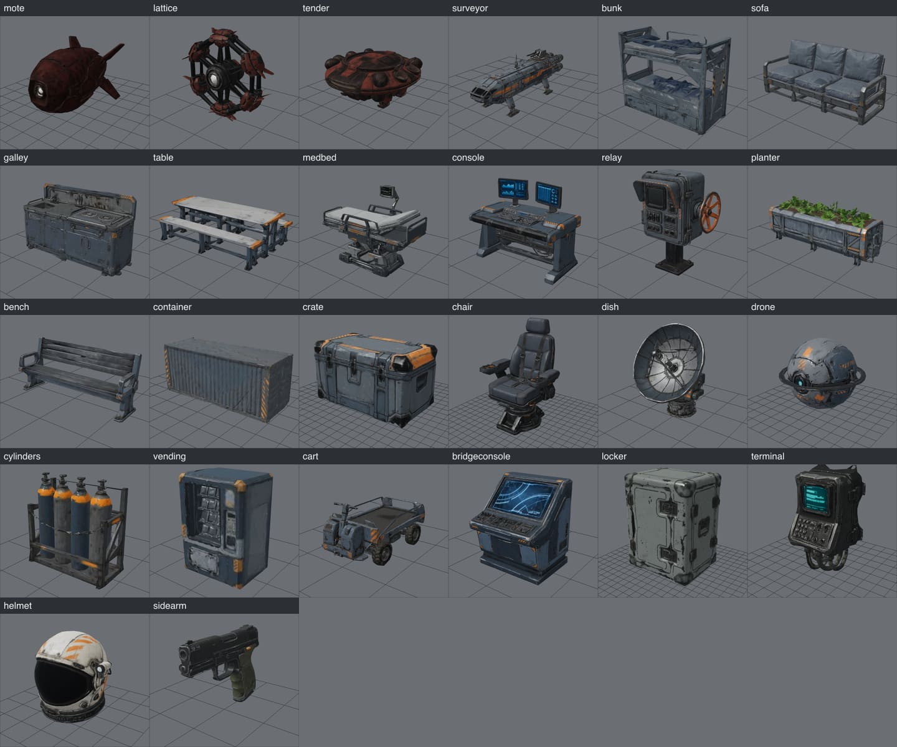

# The 3D models

The game's first hard-surface models: the swarm's three machines, the surveyor that becomes
*Lantern*, the station's furniture and props, and the four style-test objects made fit for the
game. Made on 24 October 2026 with Meshy, as the owner decided ("build everything with Meshy that
we can within the budget, and only once we run out, use the local process on my Mac"). Every file
is recorded with its source (D-28) in [art/models.json](../../art/models.json).

**Fiction.** The swarm (motes, lattices, the Tender), the surveyor and everything on the station are
invented for the game. Nothing here is taken from *Mass Effect* or any other game.



## 1. What was made

26 models in `public/assets/models/`, with a manifest, `models.json`. **14.2 MB** in all: 12.0 MB
for the 22 new models, 2.2 MB for the four from the style test. Every model:

- **faces +Z** (glTF's front, which Babylon's loader keeps as Babylon's forward),
- **stands at y = 0**, centred on X and Z,
- **is in metres**, its longest side exactly the size below,
- is one mesh with one PBR material (colour, metal and roughness, normal map), WebP textures
  (`EXT_texture_webp`) and quantised vertices (`KHR_mesh_quantization`). Babylon.js reads both with
  no decoder. Every file passes `gltf-transform validate` with no errors.

| Id | What | Size (m) | x × y × z (m) | Triangles | Texture (px) | KB | Preview |
| --- | --- | --- | --- | --- | --- | --- | --- |
| `mote` | The swarm's basic flier: plated, one emitter eye at the front, four fins | 0.6 | 0.37 × 0.33 × 0.6 | 1,984 | 512 | 228 | [mote](models/mote.jpg) |
| `lattice` | Six motes locked in a ring-frame round a core; the emitter faces front | 2.2 | 2.2 × 2.0 × 0.78 | 3,999 | 1024 | 705 | [lattice](models/lattice.jpg) |
| `tender` | The slow van-sized machine: a flattened hull, a ring, eight launch pods | 4 | 3.69 × 1.81 × 4 | 8,000 | 1024 | 762 | [tender](models/tender.jpg) |
| `surveyor` | The long-haul surveyor that becomes *Lantern*: cockpit, engines, legs, a bolted-on turret | 24 | 6.83 × 8.98 × 24 | 15,000 | 2048 | 2,353 | [surveyor](models/surveyor.jpg) |
| `bunk` | A two-tier crew bunk with mattresses | 2.1 | 2.1 × 1.64 × 1.03 | 2,452 | 1024 | 432 | [bunk](models/bunk.jpg) |
| `sofa` | A worn crew-lounge sofa | 2.2 | 2.2 × 0.98 × 0.91 | 1,992 | 1024 | 398 | [sofa](models/sofa.jpg) |
| `galley` | A galley counter with a sink, a cooker and cupboards | 2.6 | 2.6 × 1.45 × 0.99 | 3,306 | 1024 | 552 | [galley](models/galley.jpg) |
| `table` | A mess table with two benches on one frame | 2.8 | 2.8 × 0.88 × 1.89 | 1,883 | 1024 | 489 | [table](models/table.jpg) |
| `medbed` | A clinic bed with a monitor arm | 2.1 | 2.1 × 1.58 × 1.12 | 2,901 | 1024 | 564 | [medbed](models/medbed.jpg) |
| `console` | An operator's desk with two screens | 1.9 | 1.9 × 1.6 × 1.1 | 2,505 | 1024 | 522 | [console](models/console.jpg) |
| `relay` | An outdoor relay console on a post, with a hand wheel | 1.6 | 1.19 × 1.6 × 0.86 | 2,857 | 1024 | 548 | [relay](models/relay.jpg) |
| `planter` | A long hydroponic planter with leafy plants | 2.6 | 2.6 × 0.97 × 0.75 | 3,390 | 1024 | 652 | [planter](models/planter.jpg) |
| `bench` | A concourse bench | 2.4 | 2.4 × 1.05 × 0.73 | 1,220 | 512 | 168 | [bench](models/bench.jpg) |
| `container` | A six-metre cargo container (high cover) | 6 | 6 × 2.49 × 2.18 | 1,130 | 1024 | 360 | [container](models/container.jpg) |
| `crate` | A supply crate (low cover) | 1.2 | 1.2 × 0.69 × 0.71 | 930 | 512 | 177 | [crate](models/crate.jpg) |
| `chair` | The captain's chair | 1.3 | 0.9 × 1.3 × 0.76 | 3,000 | 1024 | 493 | [chair](models/chair.jpg) |
| `dish` | A relay dish for a mast top | 3 | 2.43 × 3 × 2.03 | 2,891 | 1024 | 601 | [dish](models/dish.jpg) |
| `drone` | The range's practice target: a sphere with a ring, a cyan eye | 0.7 | 0.7 × 0.58 × 0.7 | 1,499 | 512 | 204 | [drone](models/drone.jpg) |
| `cylinders` | A rack of four gas cylinders | 1.8 | 1.73 × 1.8 × 0.88 | 1,680 | 512 | 224 | [cylinders](models/cylinders.jpg) |
| `vending` | A food vending machine | 2 | 1.51 × 2 × 1.16 | 1,689 | 1024 | 189 | [vending](models/vending.jpg) |
| `cart` | A hangar cargo cart with tyres; its front is the driver's end | 2.4 | 1.28 × 1.22 × 2.4 | 2,841 | 1024 | 583 | [cart](models/cart.jpg) |
| `bridgeconsole` | A bridge console with a sloped screen | 1.6 | 1.38 × 1.6 × 1.42 | 2,390 | 1024 | 482 | [bridgeconsole](models/bridgeconsole.jpg) |
| `locker` | The style test's supply locker | 1.25 | 0.97 × 1.25 × 0.78 | 3,000 | 1024 | 505 | [locker](models/locker.jpg) |
| `terminal` | The style test's wall terminal (flat back for the wall) | 0.8 | 0.47 × 0.8 × 0.35 | 2,999 | 1024 | 579 | [terminal](models/terminal.jpg) |
| `helmet` | The style test's EVA helmet, visor to the front | 0.32 | 0.32 × 0.32 × 0.32 | 5,000 | 1024 | 609 | [helmet](models/helmet.jpg) |
| `sidearm` | The style test's sidearm, muzzle to the front | 0.24 | 0.04 × 0.18 × 0.24 | 3,999 | 1024 | 513 | [sidearm](models/sidearm.jpg) |

Each preview shows the model in the game's own Babylon.js 9.32 from six sides (front, three-quarter,
left, back, right, top), on a grid, with its measured size and base. The full-size pictures are in
`art/out/models/previews/` (not in git).

## 2. Using them in the game

`models.json` lists each model as `{ file, size, dimensions: [x, y, z], triangles, texture,
front: "+z", bytes }`. Load a model once and copy it for each use; turn and place the copy with a
holder node, because the loader's `__root__` carries its own rotation:

```ts
import { LoadAssetContainerAsync } from '@babylonjs/core/Loading/sceneLoader';
import { TransformNode } from '@babylonjs/core/Meshes/transformNode';

const base = 'assets/models/';
const { models } = await (await fetch(`${base}models.json`)).json();
const crate = await LoadAssetContainerAsync(base + models.crate.file, scene);   // once

function place(x: number, z: number, heading: number) {
  const holder = new TransformNode('crate', scene);
  holder.position.set(x, 0, z);          // the model stands on y = 0
  holder.rotation.y = heading;           // 0: the model's front faces +Z
  const copy = crate.instantiateModelsToScene((name) => name, false);   // shares geometry and textures
  copy.rootNodes[0].parent = holder;
  return holder;
}
```

- **Sizes are real.** No scaling is needed; `dimensions` gives a box for cover and collision
  (a box of `dimensions` with its bottom at the holder's origin).
- **Fliers stand at y = 0 too.** Lift the mote, lattice, tender and drone to their flying height;
  to pivot about the middle, lift the model by `dimensions[1] / 2` inside its holder.
- **Light them with reflections.** Meshy marks metal as metal (the mote's metal map averages 65%,
  the surveyor's 18%). With only the station's hemispheric and directional lights, metal reflects
  nothing and looks nearly black. The previews use a plain studio reflection (a light dome over a
  dark floor drawn once into a `ReflectionProbe`, see `scripts/art/model-preview/main.ts`); the game
  needs something similar: `scene.environmentTexture` from a probe like that, or from a small
  prefiltered `.env` made from a CC0 sky.
- **Glows are painted, not emissive.** The mote's and lattice's emitters, the drone's eye and the
  screens are in the colour texture only; no material has an emissive map. For bloom or a firing
  tell, add an emissive colour in the game (or a glow sprite at the emitter, at the front of the
  model, +Z).
- **Phones.** A room of furniture is 10–20 thousand triangles and a few MB; textures are 1024 px at
  most, except the surveyor's three 2048 px maps (about 22 MB of GPU memory once mipmapped). If
  phones struggle, process a 1024 px surveyor for the low tier (set `texture` to 1024 and re-run
  §4's `process`).
- **The style test's own files** in `public/assets/props/` are unchanged. They are unscaled
  (about 1.9 units across), centred on the origin and turned as Meshy made them. Use the four
  copies here instead (`locker`, `terminal`, `helmet`, `sidearm`): real size, facing +Z, standing
  at y = 0, and remeshed to a phone's budget. The props folder can go once the style-test gallery
  does.

## 3. Known flaws

Image-to-3D guesses the sides a picture does not show, and its guesses tend to mirror the front.

| Model | Flaw | What was done |
| --- | --- | --- |
| `mote` | From one picture, Meshy gave the tail a second glowing disc, so the front was unclear | Rebuilt from two views: the concept and a rear view Gemini drew from it (Meshy multi-image-to-3D). Now only the front has an eye; the eye is smaller than in the concept |
| `tender` | From one picture, an emitter slit on both sides | Rebuilt from two views; one slit now, at the front, dimmer than in the concept |
| `bridgeconsole` | Meshy added a cable trailing a metre across the floor behind it | Cut away in processing (`keep` in the list); a short stub remains at the back |
| `lattice` | The core has a lens at the back as well as at the front | Kept: two attempts at a rear view both came out from the front angle. The front lens faces +Z |
| `drone` | An eye at the back as well as the cyan one at the front | Kept: a rebuild from two views put an eye on each side and lost the cyan, so the first model stays |
| `bunk` | The ladder is smeared into the end frame | Kept; reads as a bunk at play distance |
| `surveyor` | Four engines in a 2 × 2 block, not two; 9 m tall with its masts | Kept; the brief's look is all there (cockpit, engines, legs, turret, orange stripes) |
| `table`, `vending` | The table is 0.88 m high; the vending machine 1.5 m wide | Scaled by the longest side, so other sides follow the concept's proportions |

## 4. How to make them again

The list is [art/models.json](../../art/models.json): for each model an id, a prompt, a style
(`swarm`, `station` or the style test's), its size, triangle budget, texture size and `turn`.
The script is `scripts/art/models.ts` (`npm run art:models -- <command>`); it needs
`GEMINI_API_KEY` and `MESHY_API_KEY` in the git-ignored `.env` and never prints them.

```sh
node scripts/art/models.ts concepts [id ...]            # Gemini pictures → art/out/models/concepts/
node scripts/art/models.ts concepts id ... --views      # redraw only the extra views
node scripts/art/models.ts meshy [id ...] --floor 1780  # Meshy models → art/out/models/meshy/
node scripts/art/models.ts remesh id ...                # a style-test model remeshed to its budget
node scripts/art/models.ts process [id ...]             # → public/assets/models/ and models.json
node scripts/art/models.ts preview [id ...]             # six views → art/out/models/previews/ and here
```

- **Concepts.** Each prompt gets its style line and a framing line: "a single object, whole and
  centred, three-quarter view from the front-left and slightly above, on a plain pure white
  background … no text, no logos". `station` is grounded near-future industrial (2180s), worn and
  lived-in, muted greys and slate blues with small orange hazard accents; `swarm` is an ancient
  machine of a vanished alien people, precise, pitted and dark, dark rust-red for the motes.
- **Views.** A model with `views` also gets those views drawn by Gemini from its concept (for
  example "from the rear-right … no light at the back"), and Meshy builds it from all of them.
  Look at each view: Gemini sometimes redraws the front angle instead of turning the object.
- **Meshy.** Image-to-3D (or multi-image-to-3D) with the latest model (Meshy 7.1), remeshed to
  triangles at the model's budget, PBR textures at 2K, GLB. `--floor` stops before a task could take
  the balance below that many credits; this run used `--floor 1780` (2,980 less the 1,200 allowed).
  A replaced model is kept as `<id>-<task>.glb`.
- **Processing**, as `props.ts` did for the style test: weld; bake the node transforms; cut away
  anything outside `keep`; turn by `turn` degrees about +Y; scale so the longest side is `size`;
  centre on X and Z with the base at y = 0; simplify to the budget with meshoptimizer; dedup and
  prune; textures to WebP at `texture` px; quantise.
- **Facing.** Meshy turns models as it likes, usually with the picture's front to +Z but long
  objects along X. Run `process` with `turn` 0, run `preview`, look at which view shows the front,
  set `turn` (90 when the front faces −X, −90 for +X, 180 for −Z), and run both again.
- **Previews** start a small Vite server on `scripts/art/model-preview/` and draw each model in
  Chromium (`--use-gl=angle --use-angle=metal`) with the game's Babylon.js.

## 5. Credits and cost

| | Credits |
| --- | --- |
| Meshy balance before | 2,980 |
| 22 models, image-to-3D with textures (30 each) | 660 |
| Mote, Tender and drone rebuilt from two views (30 each; the drone's rebuild was not kept) | 90 |
| Locker, terminal, helmet and sidearm remeshed to their budgets (5 each) | 20 |
| **Used** (of the 1,200 allowed) | **770** |
| **Left** | **2,210** |

Gemini drew 33 pictures (22 concepts, two redrawn Tender concepts and nine extra views), about
$3.30 from D-24's budget. trellis.cpp was not needed.

## 6. Records and licence (D-28)

[art/models.json](../../art/models.json) holds, for every model: the full concept prompt, its
picture's SHA-256 and date; the Meshy task id, endpoint, settings, credits, time, input hashes and
output hash; the remesh task for the four style-test models; the shipped file's SHA-256, size,
triangles, turn and dimensions; and every discarded picture or model with why it was replaced. The
pictures and Meshy's own files stay in `art/out/models/` (git-ignored); the concept pictures can be
made again from the prompts, but not identically. The Meshy models are made on the owner's paid
plan, which leaves them the owner's to use commercially; the concept pictures are the owner's to use
under Google's terms.

## 7. Next steps

- Levels of detail for the furniture and the surveyor (D-22), or a 1024 px surveyor for phones.
- Emissive masks for the emitters and screens, and the scene environment of §2.
- Collision: boxes from `dimensions` are enough for cover; the surveyor and the cart may want a few
  boxes each.
- More of the station (doors, lights, walls) from the same pipeline, while the credits last.
