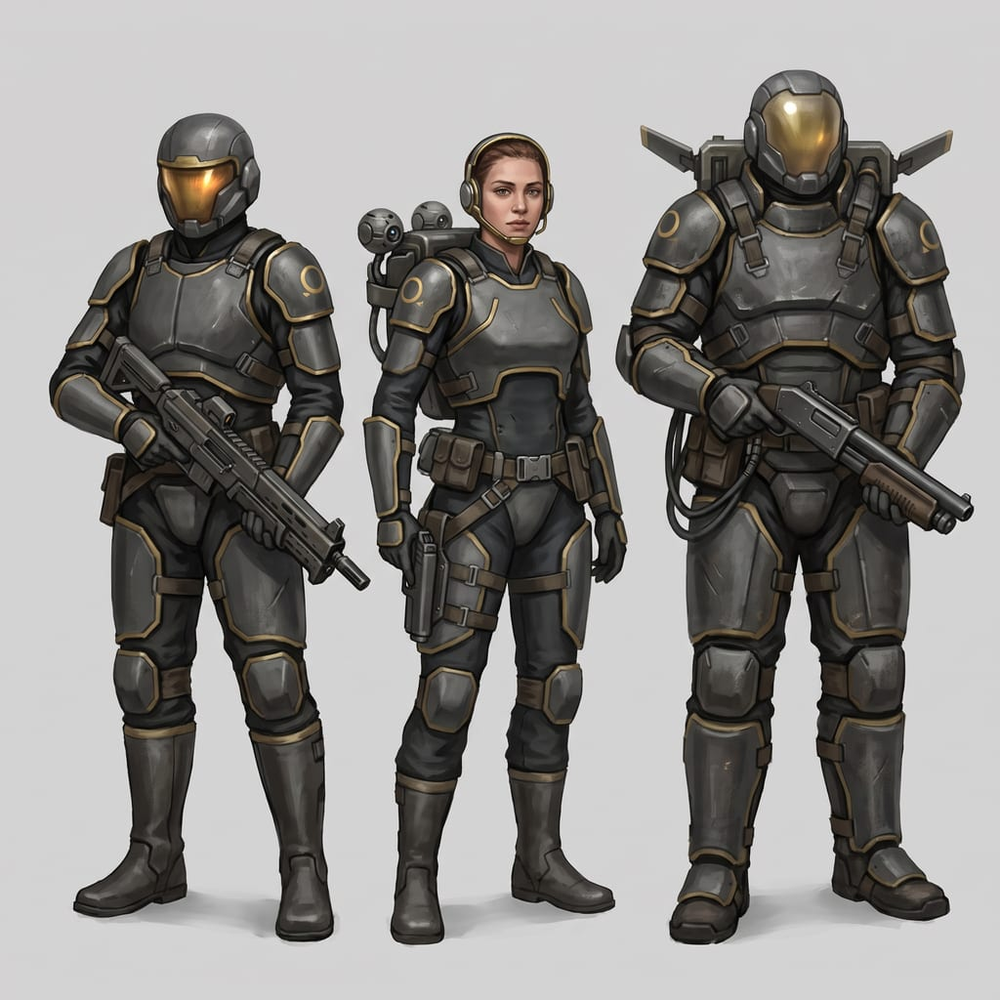
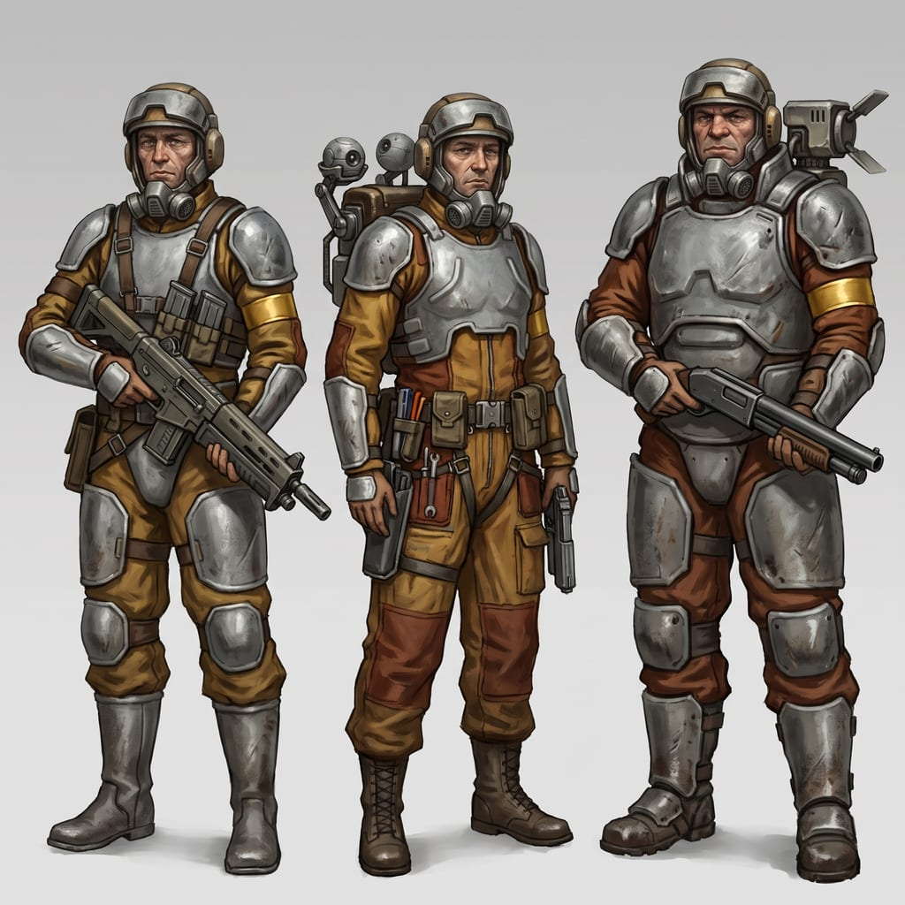
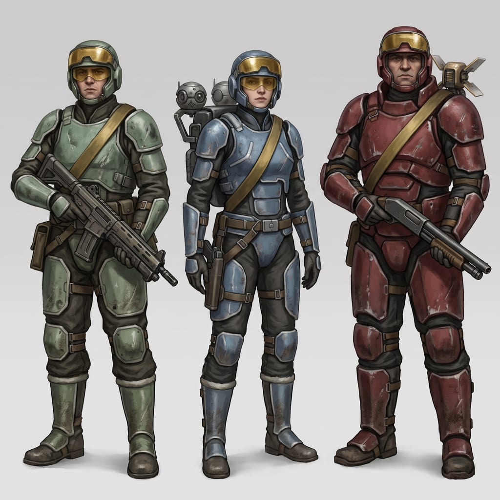

# Act 1, increment 6: the art and sound pass — a proposal

Increments 1 to 5 of Act 1's first part are built ([ACT1.md](ACT1.md)): *Lantern*'s decks, the star
map, growth and weapons, the Banked's rules, and Pyre Remnant, voiced and scored
([PYRE.md](PYRE.md)). Increment 6 is the pass that ACT1.md §7 promised: voices, music, models, and
play-testing on a phone and a desktop. The things it has to fix were noted along the way:

- the Banked still wear the hero's uniform tinted gold, with no helmets and no armour of their own;
- they say a line when a fight starts and nothing after it; Ren's, Jo's and Mira's calls in a fight
  ("With you.", "On it.", "I'm down!") are captions with no voice, the one gap left in D-23;
- the rifle, the shotgun and the marksman rifle use the pistol's sound, pitched down;
- the Gun Post is three grey boxes, the Shelter a plain see-through half sphere, and the drones
  glowing balls;
- the lane, seen from the bridge, is a dark sky with bluer stars;
- the hands hold the rifle with open, flat fingers.

The decisions it needs are round 10 in [DECISIONS.md](../DECISIONS.md) (D-66 to D-70).

## Goals

1. **The Banked look like one side**, in armour of their own, and the three kinds can be told apart
   at a glance on a phone: the trooper, the engineer with her pack, the warden behind his barrier.
2. **Both sides talk as they fight**, every line voiced (D-23): the Banked call what they do and
   what they see, and now and then speak to the hero; Ren, Jo and Mira answer orders and call out
   what matters.
3. **Every weapon sounds like itself**, and the player can hear who fired.
4. **The powers that put things in the world look made**: the Gun Post, the Shelter, the drones.
5. **The lane looks like the canon's lane**, and *Lantern* feels like a ship travelling in it.
6. **Hands close on the rifle.**
7. **Play-tested on a phone and a desktop**, with Pyre's busiest rooms measured, so the new art
   costs a phone as little as it can.

## Out of scope

New story or missions; the other two leads; armour for the hero and the companions (ACT1.md
increment 3 put "armour pieces" later); weapon makes and tiers; the Banked ship as a place; Varro's
look; facial expressions; melee animations; and the Duskfolk border's dimming star (still the
owner's, for when that lead is designed).

## 1. The Banked's own look (D-66)

**How it is made.** MakeHuman's community library, which the hero's uniform already comes from, has
three suits of armour by MatCreator, each marked CC0 in its own file. They are fitted clothes: MPFB
fits them to a body and skins them to its skeleton, as it does the uniform, so the plates move with
the arms and legs and follow the body sliders (a heavyworlder's armour is broader). Nothing new to
rig, and no new skeleton to animate.

| Piece | What it is | Used for |
| --- | --- | --- |
| *MC-SciFi-Armor Jupiter7* (MatCreator, CC0) | breastplate, shoulder plates, belt, forearm guards, thigh and knee plates, tall boots | troopers and the warden |
| *MC-SciFi-Armor Helios* (CC0) | a lighter breastplate, shoulders, forearms, thighs and boots | the engineer |
| Two helmets, made with Meshy from Gemini concepts | a closed helmet with a visor band of gold glass that glows faintly from within; an open helmet with a headset for the engineer | worn on the head, the hair hidden under the closed one |
| The warden's barrier projector (Meshy) | a squat unit on the back with emitter vanes over the shoulders | the amber barrier visibly comes from it |
| The engineer's pack (Meshy) | a pack with a cradle holding two motes | the motes she sends out leave from it |

The armour is worn over the uniform (now near-black under the plates) and recoloured. It is built
with the heroes (`scripts/art/hero.py`) and saved as separate parts beside the hair
(`looks/<body>/armour-*.glb`), with only the body's own shape sliders, not the face's, so each part
stays small. The parts load only where the Banked fight: Pyre Remnant and Calder's range with
`?banked`. On low quality, fewer triangles and 512-pixel textures, as every model has.

**Who shows a face.** The troopers and the warden fight behind their visors. The engineer's face is
seen: people, not machines, and the voices make the rest of them people too. The auditors at the
archive's doors, Esben and Quaye keep the gold-tinted uniforms they have now.

**The visor.** A band across the eyes, not a bowl over the whole face, so the helmet reads as no
other game's.

**The three looks.** Concept pictures made with Gemini, each with the trooper, the engineer and the
warden. The built armour follows the chosen concept's colours and helmets; its plate shapes are
MatCreator's, which are close to the pictures but not the same.

| A. Charcoal and banked gold (recommended) | B. Engine crews | C. Every power's colours |
| --- | --- | --- |
|  |  |  |

## 2. Battle talk (D-67)

**When the Banked speak.** Each line belongs to an event in the fight, and each kind has its own:

| Event | Who | For example |
| --- | --- | --- |
| First sight of the hero | trooper | *"Contact. Lantern's captain."* · *"There, by the racks."* |
| Into cover, moving up | trooper | *"Moving."* · *"In cover."* |
| Going round | trooper | *"I'm going round. Keep them busy."* |
| Falling back, badly hurt | trooper | *"I'm hit. Pulling back."* |
| The hero stays in cover | trooper | *"Keep their heads down."* |
| A shield on an ally | engineer | *"Shield on you. Hold still."* |
| Motes sent out | engineer | *"Sending the motes."* |
| Under fire, shield gone | engineer | *"They're on me, I need cover!"* |
| Walking in, barrier up | warden | *"Behind me."* |
| Barrier broken, barrier back | warden | *"Barrier's down. Give me eight seconds."* · *"It's back. Push."* |
| An ally falls | any | *"We've lost one."* · *"No. Get up. Get up."* |
| The last one standing | any | *"It's just me. Somebody answer."* |
| Lifted, pulled or blinded | any | *"I'm off the deck!"* · *"I can't see!"* |
| The hero goes down | any | *"Stay down. Please."* |
| To the hero, once a fight at most | any | *"It's going out anyway, Captain. All of it."* · *"We're keeping it safe. Why won't you let us?"* · *"Put it down. There's a place for you with us."* |

About 45 lines, each with two or three wordings so a fight does not repeat itself, and each voiced
by every member who can say it.

**The rules** (a pure function with tests): one Banked voice at a time, at least 2.5 seconds apart;
the same line not again within 30 seconds; a fallen member never speaks; a death, a broken barrier
and the last one standing go first; a line to the hero only when nothing else waits, once a fight;
a story line (the director's) always wins, and battle talk waits or is dropped. They are heard from
where they stand, and captioned as *Banked trooper*, *Banked engineer* or *Banked warden*.

**Five voices**, one for each member of the squad: three troopers (two men, one woman), the
engineer (a woman) and the warden (a deep, older man's voice). The Banked come from every power
(STORY.md §3), so the accents are mixed. Harry and Adam, who already speak for the Banked at Pyre,
are two of the troopers; the other three are auditioned, stock voices first (D-63 and the owner's
note).

**Ren, Jo and Mira.** Their answers to orders and their call when they go down are voiced, each in
their own words (Ren: *"On it."*; Jo: *"Aye, going."*; Mira: *"All right, I'm moving."*), and each
gains three calls about the Banked: the engineer shielding them, the warden's barrier down, the
motes coming. At most one of these every six seconds across the squad. About 12 lines each.

**Size.** About 95 Banked takes and 36 companions' takes, some eight minutes, about 4 MB, loaded with
the place as Pyre's voices are.

## 3. Sounds for the weapons, and music for fights with people (D-68)

**The weapons.** Every gun in the game is a coil gun firing solid rounds (kinetic, D-42). Each kind
gets its own shot, heard close for the hero and from a distance for everyone else:

| Sound | What it is |
| --- | --- |
| Pistol | as now |
| Rifle | quicker and thinner than the pistol: a dry crack with a short electric snap, made to repeat nine times a second |
| Shotgun | a deep, wide boom with the hiss of the coils discharging |
| Marksman rifle | a heavy, cracking report with a long tail, and a faint rising whine as it is aimed |
| The Banked's rifle | a harsher crack from the troopers' own make, so the player hears which side fired |
| The warden's field cannon | a hum building for a second, then a heavy thump (the lattice's beam sounds now) |
| The Gun Post | a light, fast tack, its unfolding, and its winding down |
| Rounds striking | a round hitting metal (three takes) and a round snapping past the ear (two) |

**Where they come from** (D-45): CC0 recordings first, ElevenLabs' sound effects where nothing fits,
each heard side by side with the others before it is chosen, as before.

**Music.** Fights with the Banked use the swarm's piece, which is written for machines: a pulse
that never stops. Fights with people get their own: low strings and drums played by hands, tense
and human, never triumphant (Lyria, as every piece). The lane gets a quiet piece of its own, too
(§5).

## 4. The powers' things (D-69)

- **Gun Post.** A model: a folding gun on three legs, the size of a toolbox. It unfolds when set
  down (half a second), turns to its target, flashes at the muzzle, and its small blue lamp dims
  through its twelve seconds before it folds and is gone.
- **Shelter.** The Warden throws a field emitter, a puck-sized model that lands and opens; the dome
  grows from it. The dome is a field, drawn as a faint shimmer that brightens at its edge, slow
  ripples across it, and a ring spreading where a bolt strikes it; it fades in its last second.
- **The same field everywhere.** One field surface (a shader, cheap enough for a phone) for the
  Shelter, the Barrier around a person, and the warden's barrier: blue for the hero's side, amber
  for the Banked.
- **The drones.** Models for the Repair Drone (Mira uses it in every fight) and the Seeker Drone,
  instead of glowing balls, each bobbing a little as it hovers.

## 5. The lane (D-70)

In the canon a lane takes 1.4 days a light-year (Reborn), so *Lantern* lives in it for a while,
and Reborn already shows a jump: a tunnel of slowly flowing violet and blue light with a bright
gate far ahead. The proposal is that tunnel, seen from inside the ship:

- through the bridge's window, looking along the course: the tunnel's walls streaming past and the
  gate's light far ahead;
- through the mess's window: the wall flowing past sideways;
- a cool, slowly moving light from it across the bridge;
- a low hum on the bridge, and a quiet piece of music of its own (it plays the prologue's night
  piece now).

On a phone it is one mesh and one shader drawn behind everything, as the sky is.

## 6. Hands on the rifle (made without waiting)

The rifle clips' fingers are set in Blender with the rest of the hold (`rifle_clip` in
`scripts/art/common.py`; the skeleton has three bones in each finger and the thumb): the right hand
closed round the grip, the forefinger laid straight along the guard and onto the trigger when
firing; the left hand cupped under the handguard, the thumb round it. For both bodies and everyone
who uses the clips: the hero, the companions and the Banked. The pistol's grip is checked the same
way.

## 7. Play-testing, phone and desktop

- **Measured on the Mac** at phone size with low quality: Pyre's commons (the most people) and the
  stacks (a full squad and its motes), before and after the armour, the helmets and the fields. If
  the new art costs a frame more than about a tenth, the low tier gets lighter copies until it does
  not.
- **The owner plays** on the Android phone and a desktop and reports from screenshots.
- **Tests.** Unit tests for the battle talk's rules, that every weapon kind and Banked event has a
  sound and a line, and that each Banked kind is dressed in its parts. Browser journeys on a phone
  and a desktop: the Banked in their armour on the range, a line heard in a fight, each weapon's
  sound played, the Gun Post's model, the Shelter's field, and the lane through the bridge window.
  Screenshots at phone, tablet and desktop sizes.

## 8. What it costs, and the order of building

**Spending.** Meshy: eight models (two helmets, the projector, the pack, the Gun Post, the Shelter's
emitter and two drones), about 240 of the 1,910 credits left. ElevenLabs: about 130 voice takes and
15 sound effects. Lyria: two pieces. Gemini: about ten concepts. All within what the owner has
already paid for, and within D-24.

**Steps**, each pushed with the checks passing (D-01):

1. Hands on the rifle, and Ren's, Jo's and Mira's calls voiced.
2. The Banked's armour, helmets, projector and pack.
3. Battle talk: the rules, the lines, the five voices.
4. The weapons' sounds and the fight music.
5. The powers' things: the Gun Post, the emitter, the drones, the field surface.
6. The lane.
7. The measuring pass, the play-test fixes and the asset records.

## The decisions it needs

Round 10 in [DECISIONS.md](../DECISIONS.md): D-66 the Banked's look, D-67 battle talk, D-68 the
weapons' sounds and the music for fights with people, D-69 the powers' things, D-70 the lane.
**Decided:** all five as recommended, 25 October 2026.

## 9. As built

The steps of §8, as each is pushed.

1. **Hands on the rifle, and the companions' calls voiced** (25 October 2026). Looking closely
   showed more than open fingers: the rifle clips were built along the pistol pose's shoulders,
   about 15° off the direction the game points the gun, and both palms faced back towards the
   shooter, so neither hand could meet the gun. The clips are now built round the body's forward,
   each hand is turned by its knuckles, and the fingers close round the grip (the forefinger on
   the trigger, along the guard when ready) and under the forend. Each long gun has its own hold,
   measured from its model: the rifle, the shotgun (the left hand on the pump) and the marksman
   rifle; the rifle is held at 0.84 m so its long stock meets the shoulder (ART_PIPELINE.md).
   Ren, Jo and Mira answer orders and call out in their own words (`src/game/fight-talk.ts`),
   39 lines voiced, heard from where they stand.
2. **The Banked's armour, helmets, projector and pack** (25 October 2026). MatCreator's CC0
   armour, simplified and recoloured charcoal and dull gold, fitted to both bodies and worn over a
   near-black uniform; the engineer's is the same without thigh and knee plates. The closed helmet,
   the engineer's open helmet, her pack with two motes and the warden's projector are Meshy models
   on the head and the upper spine (`GEAR` in `src/game/banked.ts`). Built with the same run: the
   Gun Post, the Shelter's emitter and the two drones, for step 5 (240 Meshy credits, 1,670 left).
3. **Battle talk** (25 October 2026). The Banked call what they do and see, and once a fight say
   something to the hero (`src/game/fight-talk.ts`: 16 calls, 113 takes in five voices); `banked.ts`
   raises each moment (in sight, into cover, going round, falling back, dug in, a shield given, motes
   sent, a shield or the barrier lost or back, a fall, the last one, lifted or blinded) and the game
   says a line by the rules: one voice at a time, 2.5 seconds apart, no line again within 30, a
   death and a broken barrier first, the story's own lines always before them. Ren, Jo and Mira
   answer three of those moments (the engineer's shields, the barrier down, motes) a moment later,
   at most once every six seconds.
